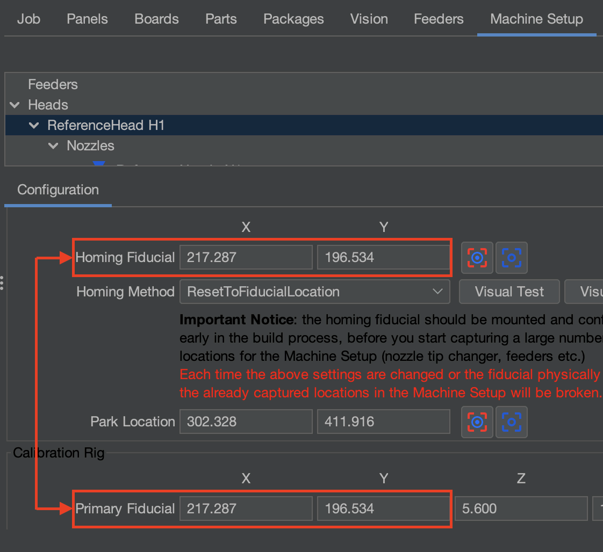
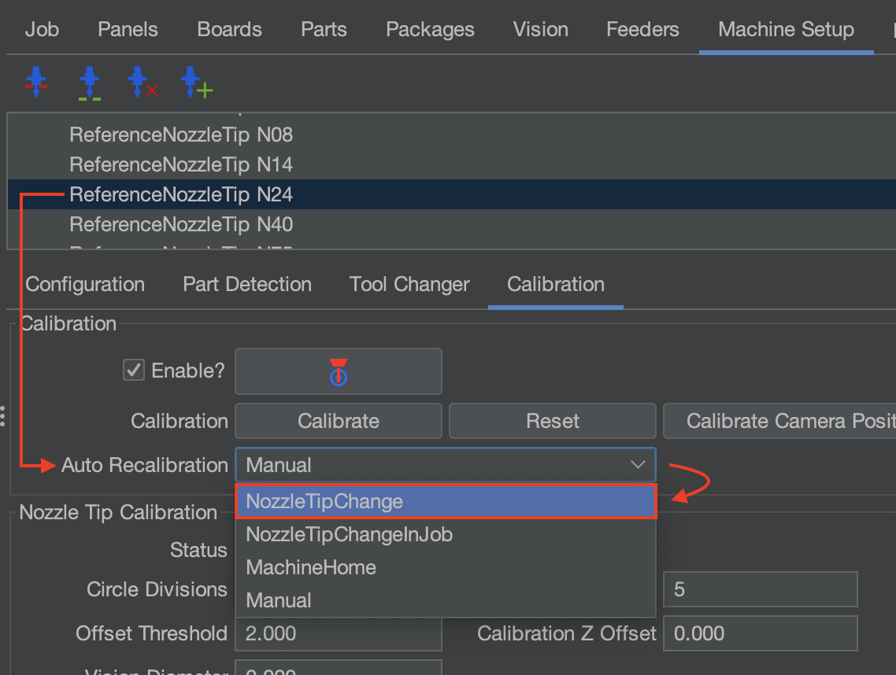

# Prepare Your LumenPnP for Homing

---

## What homing should look like

Before continuing, confirm that `ResetToFiducialLocation` is configured as part of your homing method. This should have been configured when setting up the bottom camera position. If it was not, follow the instructions below to configure it. Confirm this is set before continuing.

When you press the Home button, the head will not remain in the front-left corner like before. Instead, the top camera will move to the primary fiducial to locate and center itself on the exact center of the fiducial.

After the fiducial homing process is complete, OpenPnP will automatically continue to calibrate any installed nozzle tips that are configured for `NozzleTipChange` calibration, which we will set up next. Any nozzle tips configured for NozzleTipChange recalibration will be automatically calibrated during this process. In the following steps, I would recommend turning this on for all nozzle tips, even if you don't plan to use one right away.

The following steps will enable nozzle tip scanning during the homing sequence.

## What this step does

Homing requires a precise, consistent location to call upon and center itself on after homing is initiated. The end stops provide a repeatable starting point, but small amounts of mechanical variation can still exist after each homing cycle. The Homing Method `ResetToFiducialLocation` uses a known fiducial location to perfect the machine's position after homing, which improves the repeatability and placement accuracy.

Turning on `NozzleTipChange` allows the homing sequence to perform a nozzle runout calibration, which measures how the center of a nozzle tip appears to shift in X or Y as it rotates under the bottom vision camera. This shift can be caused by manufacturing tolerances, mounting variation, or slight misalignment between the nozzle and rotation axis. OpenPnP calculates this offset and compensates for it during placement. This ensures the center of the component remains accurately aligned regardless of nozzle rotation.

---

## Prepare for Homing your machine

Before you can properly use the LumenPnP, you must ensure the following changes have been made before homing the machine. Without these changes, your machine will be inaccurate.

**Set your Homing Method**

Confirm the following settings before homing the LumenPnP.

### Homing Method

* Go to `Machine Setup > Heads > ReferenceHead H1 > Homing Method` and ensure it is changed from `None` to `ResetToFiducialLocation`

    
* While here, confirm that the homing fiducial's XY coordinates match what is set for the primary fiducial.

    

### Nozzle Tip Runout

* (Apply this to all nozzles that will be used. We plan to use the `N045` and `N24` nozzle tips for validation.)
* Go to `Machine Setup > Nozzle Tips > ReferenceNozzleTip N045 > Calibration Tab > Auto Recalibration dropdown` and change it from `Manual` to `NozzleTipChange`

    
* Go to `Machine Setup > Nozzle Tips > ReferenceNozzleTip N24 > Calibration Tab > Auto Recalibration dropdown` and change it from `Manual` to `NozzleTipChange`

    

---

## Calibration Complete

Calibration is done and homing has been configured. Now, all we need to do is validate that the machine is properly calibrated and placing parts in a controlled environment. To do this, we'll populate the FTP board with components.

 **Do not continue with any other steps within Issues and Solutions until the FTP Board has been successfully validated with proper placements. Verifying the FTP Board with a known working position file and PCB that we supply ensures the machine is properly calibrated and provides a safe environment to test your placement of parts before using your own.**

Next Step

We need to validate that the machine is properly calibrated and placing parts in a controlled environment. We'll use the FTP board to accomplish this.

<a href="../../v4-1/controlled-validation-test/introduction/" class="next-step">Validation Test →</a>

