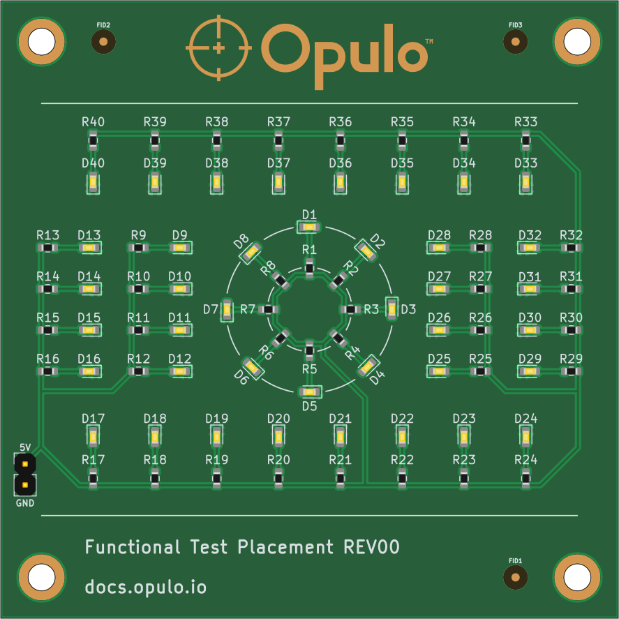

# FTP Test Board Validation

You've finished calibrating your LumenPnP! Before assembling your own PCB designs, we'll verify the machine's performance using the supplied **FTP test board**.

Think of this like printing a test page before an important document. It gives us a consistent way to check that the machine is picking, aligning, and placing components accurately.

!!! danger "Before proceeding"
    If you've just finished the OpenPnP calibration process, verify that your homing method is set to `ResetToFiducialLocation`.

    This allows OpenPnP to use the calibration fiducial as a reference when homing, which is important for accurate placement of small components such as 0402s.

{ width="420" }

---

## Why Use the FTP Test Board?

  

    <h3>✓ FTP Test Board</h3>
    <strong>Known, tested starting point</strong>
    
Its board layout, placement files, and components have already been tested and confirmed to work together.

    
Starting with a proven setup allows us to focus on verifying the machine's calibration and placement accuracy.

  

  

    <h3>Your Own PCB</h3>
    <strong>Introduces unknown variables</strong>
    
Your own PCB design introduces variables that haven't been validated yet, such as board origin, rotation, CAD export settings, and component definitions.

    
If something goes wrong, it becomes harder to determine whether the issue is with calibration or the PCB setup.

  

  <strong>Start with what we know works.</strong>
  
By validating with the FTP board first, you can confirm your LumenPnP is working correctly before introducing the unknowns of your own designs.

---

## What We'll Do

We'll prepare the FTP board, configure its placement data, and get the machine ready for a test job.

-   **1. Mount the FTP PCB**

    ---

    Install the mounting hardware, apply double-sided tape, and securely mount the board to the staging plates.

-   **2. Import the Board**

    ---

    Download the placement file, create the board in OpenPnP, and configure the components.

-   **3. Locate the Board**

    ---

    Set the board's position and height, then use its fiducials to refine alignment.

-   **4. Prepare the Job**

    ---

    Configure the remaining placements and save the job for the upcoming test.

!!! info "What's included?"

    You'll use the supplied FTP PCB and test components along with the placement file provided in this guide.

    No solder paste is required. We'll use double-sided tape to hold the test components in place.

---

## What Does a Successful Test Look Like?

Once the FTP job is running, we'll check that the machine can consistently pick and accurately place components.

-   **Accurate Positioning**

    ---

    Components land on their intended pads without noticeable offset.

-   **Correct Orientation**

    ---

    Components are properly centered and rotated during placement.

-   **Repeatable Results**

    ---

    The machine consistently places components in the correct locations.

!!! tip "Why validate now?"
    If something isn't working correctly, it's much easier to troubleshoot with a known test board than with a custom PCB.

    We'll use the results to identify anything that may need further adjustment before moving on to your own designs.

---

## After Validation

Once the FTP test job is successful, you'll have a verified starting point for assembling your own PCBs.

You'll be ready to import your own board designs, load their placement files, and begin setting up your own components and feeders.

Next Step

Let's prepare the FTP board and configure it in OpenPnP.

<a href="../validation/board-validation/" class="next-step">FTP Board Setup →</a>

