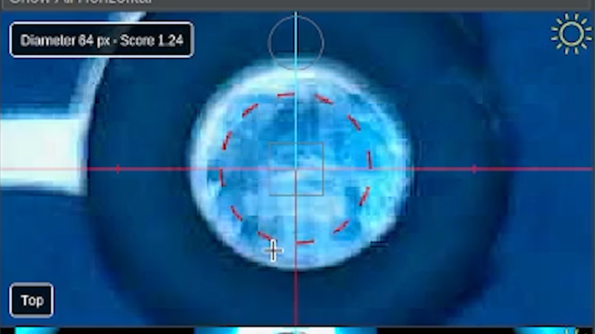
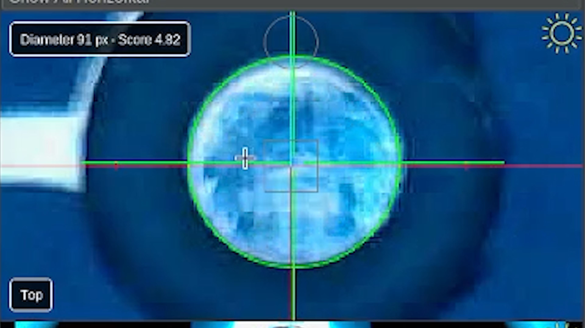

# Primary Calibration Fiducial Position

## Getting Started with Issues & Solutions

### Step 1: Open and Refresh Issues & Solutions

* In OpenPnP, locate and select the **Issues & Solutions** tab near the top-right corner of the application to open the calibration task list.. {color=blue}
    
* The first step is a preliminary step, which asks us to home the LumenPnP.   We do not need to home the machine because we have already done so earlier. {color=blue}
* Locate the **Find Issues & Solutions** button, and click it to refresh the available calibration tasks. {color=green}
* OpenPnP will check the current configuration, remove completed tasks, and display the next issues requiring attention. {color=green}
* After clicking the **Find Issues & Solutions** button, the list will populate the next task you need to complete. {color=green}
    

!!! tip "Refresh After Every Calibration Task"
    After completing an Issues & Solutions task, always click **Find Issues & Solutions** again.

    This updates the list and allows OpenPnP to identify the next task that needs to be completed.

### Step 2: Select **Primary calibration fiducial position & initial camera calibration**

* After clicking **Find Issues & Solutions** in the previous step, locate the next task **Primary calibration fiducial position & initial camera calibration**. {color=blue}
    

### Step 3: Locate the Primary Fiducial

The primary fiducial is the taller of the two circular calibration markers located around the bottom camera location on the LumenPnP.

* Locate the primary fiducial on your machine. {color=blue}
* We'll use the top camera to identify its exact position in OpenPnP. {color=blue}
    

### Step 4: Move the Top Camera Over the Fiducial

* First, ensure the nozzles are clear from colliding with anything.
* In **Machine Controls**, locate the **X/Y Jog Controls**. {color=blue}
* Use the jog controls to move the top camera toward the primary fiducial. {color=blue}
* As you approach the fiducial, reduce the jog distance for more precise movement. {color=blue}
* Continue until the primary fiducial is approximately centered in the top camera preview. {color=blue}
    

!!! tip "Different Reticles"
    Right click on the top camera and choose reticle to see which reticle you prefer to use.

    We use the fiducial reticle in most of this guide.

## Detect and Calibrate the Fiducial

### Step 5: Detect the Primary Fiducial

Once the camera is centered over the primary fiducial, return to the Issues & Solutions task.

* Locate the **Feature Diameter** setting. (If you do not see it, try scrolling down in the bottom pane){color=blue}
* Adjust the feature diameter value until OpenPnP correctly detects the primary fiducial. {color=blue}
* You can manually adjust the value, enter a number, or use the automatic scanning option. {color=blue}
    
* When adjusting the feature diameter, in the top camera view, a score appears beside the feature diameter size. Your goal is to get the highest score possible. {color=yellow}
    
* A **red dotted circle** indicates that OpenPnP has not found an acceptable circle. {color=red}
    
* A **solid green circle** indicates an acceptable detection. {color=green}
    

About using the automatic scan feature:

* If you are not sure what to set the Feature Diameter to, feel free to use the Auto-Detect button to ensure you get a good circle detection score.{color=purple}
* A **red dotted circle** will expand as OpenPnP searches for the fiducial, and when a potential match is found, the circle becomes **solid green**. {color=purple}
* OpenPnP continues searching and then selects best match it found. {color=purple}
* It can take a while for the whole process to complete. The scan will auto update the Feature Diameter when it is done. {color=purple}
    

### Step 6: Accept the Calibration

* Once you are satisfied with the detected circle, click the **Accept button** below the feature diameter. {color=green}
    
* OpenPnP will briefly move the camera around the fiducial to calculate its position. {color=blue}
* Allow the process to finish without interrupting the machine. {color=blue}
    

!!! info "Why Does the Machine Move?"
    OpenPnP uses these small movements to calculate the fiducial position and begin calibrating the top camera.

    These movements are expected during this step.

## Complete the Calibration

### Step 7: Refresh Issues & Solutions

* Confirm that the primary fiducial issue is marked **Solved**. {color=green}
    
* Click **Find Issues & Solutions** to refresh the task list. {color=blue}
* OpenPnP will identify the next task requiring attention. {color=blue}
    

### Next Steps

!!! success "Primary Fiducial Calibrated"
    You've successfully established the primary calibration fiducial's position.

    This fiducial will serve as an important reference point for normal operation.

* Next, we'll locate and calibrate the secondary fiducial using the same general process.
    

<a href="../secondary-cal-fid-pos/" class="next-step">Calibrate Secondary Fiducial →</a>