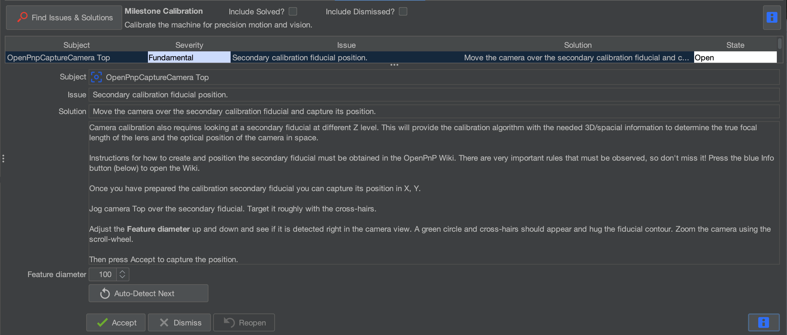

# Secondary Fiducial Position

For this task, we'll locate and calibrate the secondary fiducial using the same process as the primary fiducial.

## Locate the Secondary Fiducial

### Step 1: Select **Secondary calibration fiducial position & initial camera calibration**

* After clicking **Find Issues & Solutions** in the previous step, locate the task **Secondary calibration fiducial position & initial camera calibration**. {color=blue}
    

### Step 2: Locate the Secondary Fiducial

* Locate the secondary fiducial on your machine. {color=blue}
* It is to the right of the primary fiducial, and slightly lower than it. {color=blue}
    
* We'll use the top camera to record its position, just as we did with the primary fiducial.

### Step 3: Move the Top Camera Over the Fiducial

* Make sure both nozzles have enough clearance before moving the machine.
* Using the **X/Y Jog Controls**, move the top camera over the secondary fiducial. {color=green}
* Reduce the jog distance as you approach the fiducial. {color=green}
* Center the secondary fiducial in the top camera preview. {color=green}
    

## Detect and Calibrate the Fiducial

### Step 4: Detect the Secondary Fiducial

* Locate the **Feature Diameter** setting in the Issues & Solutions task. {color=blue}
* Adjust the diameter until the secondary fiducial is correctly detected. {color=blue}
* Aim for a good detection score while confirming that the circle matches the actual fiducial. {color=yellow}
    

* A **red dotted circle** indicates that OpenPnP has not found an acceptable circle. {color=red}
    
* A **solid green circle** indicates an acceptable detection. {color=green}
    

* You can use **Auto-Detect** to automatically scan for the best Feature Diameter if you're unsure what value to use. {color=purple}
    

!!! tip "Auto-Detect Is An Option"
    If you are not sure about your detected circle, consider using the Auto-Detect feature to help.

### Step 5: Accept the Calibration

* Once the fiducial is correctly detected and you found a good score, click the **Accept button** below Feature Diameter. {color=green}
    
* OpenPnP will briefly move the camera around the fiducial to calculate its position. {color=blue}
* Allow the process to finish without interrupting the machine. {color=blue}
    

## Complete the Calibration

### Step 6: Refresh Issues & Solutions

* Confirm that the secondary fiducial task is marked **Solved**. {color=green}
    
* Click **Find Issues & Solutions** to refresh the task list. {color=blue}
    

### Next Steps

!!! success "Secondary Fiducial Calibrated"
    Both primary and secondary fiducial positions have now been recorded by the top camera.

    OpenPnP can use these reference points to establish the position and orientation of your LumenPnP's calibration references.

* Next, we'll calibrate the position of **Nozzle N1 relative to the top camera**, using the primary fiducial.
    

<a href="../n1-offset-primary/" class="next-step">Calibrate Nozzle N1 Offset →</a>
