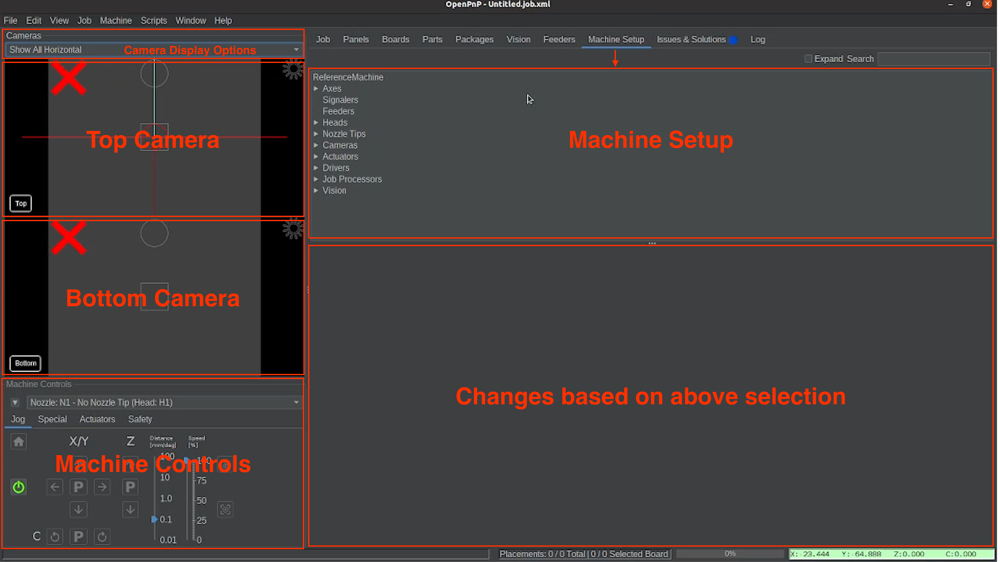

# Connect Your LumenPnP

Now that your LumenPnP configuration files are installed, it's time to connect OpenPnP to your machine.

Before connecting, we'll take a quick look at the OpenPnP interface and the controls you'll use throughout calibration.

## 1. Get to Know OpenPnP

{ .openpnp-overview-image }

OpenPnP has several panels for managing your LumenPnP. The two we'll focus on are:

- **Machine Setup:** Used to configure drivers, cameras, nozzles, and other machine settings.
- **Machine Controls:** Located in the bottom-left corner. Used to connect, home, and manually control the machine.

You'll use both of these areas throughout the calibration process.

## 2. Machine Controls Overview

The Machine Controls panel contains three tabs: **Jog**, **Special**, and **Actuators**.

Flip through the tabs below:

=== "Jog"

    The Jog tab contains the controls you'll use most frequently during calibration.

    { .machine-controls-image }

    | # | Control | What It Does |
    |---|---|---|
    | 1 | **Power** | Connects or disconnects OpenPnP from the LumenPnP. |
    | 2 | **Home** | Home icon that starts the machine's homing process. |
    | 3 | **Nozzle Selection** | Dropdown that switches between nozzles N1 and N2. |
    | 4 | **X/Y Jog** | Moves the machine head along the X and Y axes. |
    | 5 | **Z Jog** | Raises or lowers the selected nozzle. |
    | 6 | **C Jog** | Rotates the selected nozzle in degrees. |
    | 7 | **Jog Distance** | Changes how far the machine moves per jog command. |
    | 8 | **Speed Percentage** | Changes the speed of the machine speed slider. |

    !!! info "Jogging During Calibration"
        Smaller jog distances are useful when making precise adjustments. We'll cover jogging in more detail when it's needed.

=== "Special"

    The Special tab provides controls for handling picked components.

    { .machine-controls-image }

    | # | Control | What It Does |
    |---|---|---|
    | 1 | **Recycle** | Returns a picked component to its original pocket in the tape. |
    | 2 | **Discard** | Discards a picked component into the discard bin. |

=== "Actuators"

    The Actuators tab allows you to manually control the LEDs and pumps.

    { .machine-controls-image }

    | # | Control | What It Does |
    |---|---|---|
    | 1 | **LEDs** | Turn machine and camera lighting on or off. |
    | 2 | **Vacuum Pumps** | Activate or deactivate vacuum. | 
    | 3 | **Vacuum Sensors** | View available vacuum readings. |   

!!! tip "Useful Camera Controls"
    **Zoom:** Hover your mouse over either camera feed and use the mouse scroll function to zoom in or out.

    **Crosshair and Ruler:** Right-click a camera preview, open the crosshair options, where there are different ones that can help assist you during calibration. This is helpful when positioning and calibrating fiducials and nozzle tips.

!!! warning "Do Not Home or Jog the Machine Yet"
    We'll first configure both cameras and make sure the nozzles are level. Homing and machine movement will be covered in later steps.

---

## 3. Power On Your LumenPnP

Before establishing a connection:

1. If you have launched OpenPnP, close the program and then continue.
2. Make sure your LumenPnP power supply is connected and switched on.
3. Connect the LumenPnP to your computer using USB.
4. Launch OpenPnP if it isn't already running.

You are now ready to select the machine's serial port.

## 4. Select the Serial Port

OpenPnP communicates with the LumenPnP through a USB serial connection.

1. Select the **Machine Setup** tab.
2. Expand **Drivers** in the configuration tree.
3. Select **GcodeDriver**.
4. Open the **Configuration** tab.
5. Locate the **Port** dropdown and select the serial port connected to your LumenPnP.

{ .connection-guide-image }

=== "Ubuntu Linux"

    Your LumenPnP will typically appear as:

    ```text
    /dev/ttyACM0
    ```

    It may also appear as `/dev/ttyACM1` or another number.

=== "Windows"

    Your LumenPnP will typically appear as:

    ```text
    COM3
    COM4
    COM5
    ```

    The exact COM number depends on your computer.

!!! tip "Not Sure Which Port to Select?"
    Go through the list of ports until one connects.

!!! danger "No Serial Port Available?"
    If no appropriate serial port appears, stop here.

    Verify that the LumenPnP is powered on, the USB cable is properly connected, and your computer recognizes the controller.

!!! tip "If You Disconnect the USBs while OpenPnP is running"
    OpenPnP may hold on to the original serial port and create a new one that you would have to temporarily use until you reboot your computer. Once rebooted, OpenPnP will most likely make you switch it back to the original serial port. To avoid this, ensure OpenPnP is closed before disconnecting the USBs.

## 5. Connect to Your LumenPnP

Once you've selected the correct serial port:

1. Locate the **Machine Controls** panel in the bottom-left corner of OpenPnP.
2. Click the **green Power button**.
3. Allow OpenPnP to establish communication with the machine.

{ .connection-guide-image }

**When successfully connected:**

- The Power button changes from **green to red**.
- The Home button becomes available and appears **yellow**.
- OpenPnP can now communicate with your LumenPnP.

!!! success "Connection Established"
    If the Power button is red and OpenPnP reports no connection errors, your LumenPnP is connected.

    **Do not click the Home button yet.** We'll configure both cameras and check that the nozzle tips are level before homing the machine.

## Connection Troubleshooting

If OpenPnP cannot connect, check the following:

| Problem | What to Check |
|---|---|
| No serial port appears | Check the USB cable and confirm the computer detects the controller. |
| Connection fails | Make sure the correct serial port is selected. |
| Port disappeared | Reconnect USB and check the available ports again. |
| Still cannot connect | Completely close and restart OpenPnP, then try again. |

## Next: Connect Your Top Camera

<div class="config-next-panel" markdown>

**LumenPnP Connected?**

Now that OpenPnP is communicating with your LumenPnP, we'll connect the top camera and configure its settings.

<a href="../connect-cameras/" class="next-step">Configure Your Top Camera →</a>

</div>
