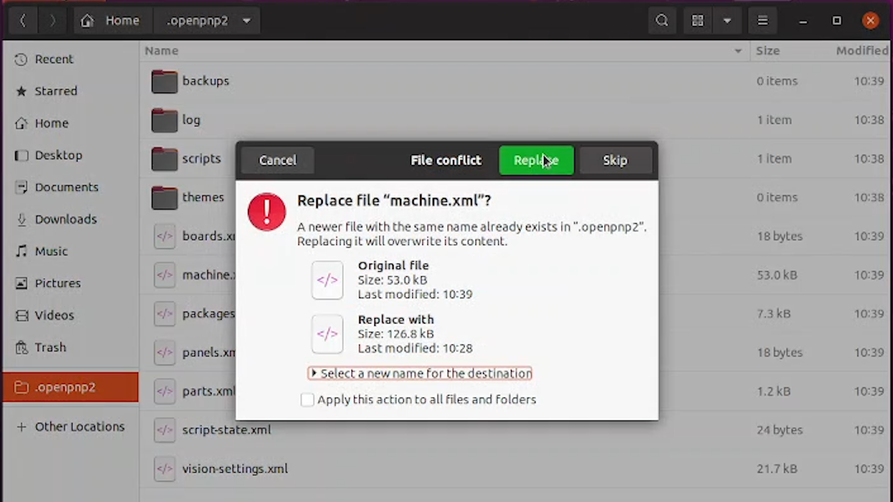

# Import Your LumenPnP V4.2 Configuration

OpenPnP needs configuration files specific to your LumenPnP before it can communicate with the machine.

This guide will walk you through replacing the default OpenPnP settings with the correct **LumenPnP V4.2 configuration**.

## 1. Download the Configuration Files

<div class="config-download-panel" markdown>

**LumenPnP V4.2 Configuration**

Download the configuration package for your machine.

<a href="https://github.com/opulo-inc/lumenpnp/releases/download/v4.2.0/OpenPnP_Config_v4.2.0.zip" class="config-download-button">↓ Download V4.2 Configuration Files</a>

After downloading, extract the ZIP file. You should find these two files:

<div class="config-file-list" markdown>

- `machine.xml`
- `vision-settings.xml`

</div>

</div>

These files contain the machine and vision settings required for your LumenPnP.

## 2. Close OpenPnP and Back Up Your Settings

!!! danger "Close OpenPnP Before Continuing"
    OpenPnP must be completely closed before replacing its configuration files. Otherwise, your changes could be overwritten or result in an inconsistent configuration.

If you have previously configured OpenPnP, **back up your existing `.openpnp2` folder** before continuing. This preserves your current machine settings, feeders, and other customizations.

## 3. Locate Your Configuration Folder

OpenPnP stores its configuration files in a hidden folder named `.openpnp2`.

=== "Ubuntu Linux"

    1. Open your **Home** folder.
    2. Press `Ctrl + H` to show hidden files.
    3. Locate and open the `.openpnp2` folder.

    Your configuration folder is located at:

    ```text
    ~/.openpnp2
    ```

    { .config-guide-image }

=== "Windows"

    1. Open **File Explorer**.
    2. Enable **Hidden items** under the View menu.
    3. Navigate to your user folder.
    4. Open the `.openpnp2` folder.

    Your configuration folder is located at:

    ```text
    C:\Users\<your username>\.openpnp2
    ```

!!! info "Can't find the .openpnp2 folder?"
    Launch OpenPnP once, allow it to load, and then close it completely. This initializes the default configuration folder.

## 4. Replace the Configuration Files

With OpenPnP closed, and the `.openpnp2` folder open:

1. in the `.openpnp2` folder, delete the stock machine.XML and vision-settings.XML
    { .config-guide-image }
2. Open the ZIP folder you extracted earlier.
3. Copy `machine.xml` and `vision-settings.xml`.
4. Paste both files into your `.openpnp2` folder.
    { .config-guide-image }
5. If it prompts you to replace the existing files, that means the original files didn't get deleted, but that is fine. Click the button to replace the two files with the new configuration files we supplied. Then, confirm the two copied configuration files in `.openpnp2` folder match the file size of the ones you downloaded from us.

{ .config-guide-image }

!!! tip "Only Replace These Two Files"
    You only need to replace `machine.xml` and `vision-settings.xml`. Leave the other files in `.openpnp2` unchanged.

<div class="config-info" markdown>

**What do these files do?**

- `machine.xml` contains your LumenPnP's machine, motion, camera, and hardware configuration.
- `vision-settings.xml` contains the vision settings used during calibration and operation.

These files provide the starting configuration for your LumenPnP V4.2.

</div>

## 5. Verify the Configuration

1. **Launch OpenPnP** and allow it to load completely.
2. Open **Machine Setup** and check that the expected LumenPnP machine configuration is present.

!!! success "Configuration Imported"
    If OpenPnP loads your machine configuration without errors, you're ready to continue. Camera and machine connections will be configured in the next steps.

## Next: Connect Your LumenPnP

<div class="config-next-panel" markdown>

**Ready to Connect Your Machine?**

Your LumenPnP V4.2 configuration files are installed. Next, you'll establish communication between OpenPnP and your LumenPnP.

<a href="../establish-connection/" class="next-step">Connect Your LumenPnP →</a>

</div>
