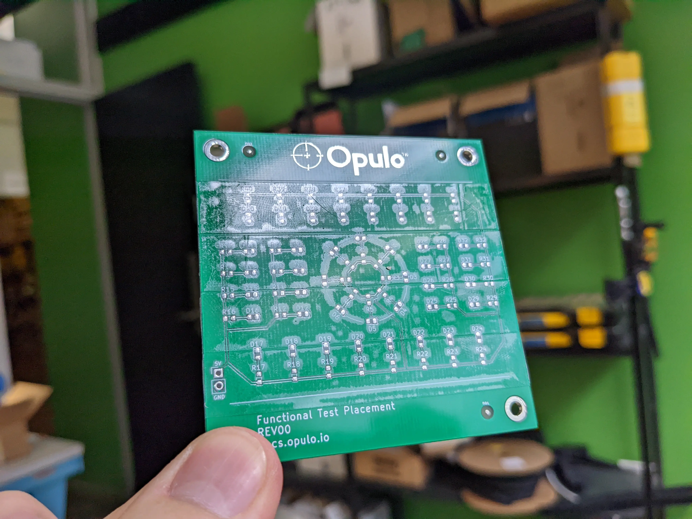

# Calibration PCB Validation

You've finished calibrating your LumenPnP! Next, we'll set up the **FTP PCB** to validate the machine's calibration through a test job.

We'll mount the test board, import its placement data, and tell OpenPnP exactly where the PCB is located.

---

## 1. Mount the FTP PCB

First, we'll install the mounting hardware and secure the FTP board to the LumenPnP.

### Install the mounting hardware

Place the three mounting components in the positions shown below:

- **3x M4 Thumbscrews**
- **2x Static Board Mount**
- **1x Dynamic Board Mounts**

!!! info "LumenPnP V4.2 mounting positions"
    The V4.2 staging and build plates do not have numbered mounting holes. **Use the photo below to identify the correct mounting positions and orientations.**

    Leave the mounting hardware slightly loose for now so you can adjust its position when installing the PCB.

### Apply double-sided tape

The FTP PCB uses double-sided tape to hold components during the test, eliminating the need for solder paste.

1. Apply **four strips of double-sided tape** between the two white horizontal lines on the PCB.
2. Keep the tape flat and evenly applied.
3. Make sure **none of the fiducial markers are covered**.

### Secure the FTP PCB

1. Place the FTP PCB between the mounting components.
2. Slide the mounts snugly against the PCB edges.
3. Align the PCB's top edge with the ridge in the dynamic mount's tab.
4. Gently pull back the dynamic mount tab while pressing the PCB into position, allowing the board to slip past the tab's raised section.
5. Once the PCB is seated, **tighten the mounting hardware**.

!!! success "Check before continuing"
    The PCB should sit flat and remain firmly in place without noticeable movement or wobbling.

    The board should only release when the dynamic mounting tab is pressed.

---

## 2. Import the FTP Position File

Now we'll import the FTP PCB's placement data into OpenPnP so it knows which components belong on the board.

### Download the position file

Download the FTP board's placement file below.

<a href="https://github.com/opulo-inc/lumenpnp/releases/download/v4.1.0/ftp-top.pos" class="download-button">Download ftp-top.pos</a>

### Create a new board

1. Open the `Jobs` tab in OpenPnP.
2. Click the green **+** button.
3. Select `New Board...`.

4. When prompted, save the new board as `ftp.board.xml`.

### Import the placements

With your new board selected:

1. Navigate to `File > Import Placements > KiCAD .pos`.

2. Select your downloaded `ftp-top.pos` as the **Top File (.pos)**.
3. Enable `Assign Parts`.
4. Enable `Create Missing Parts`.
5. Click `Import`.

### Change the Assigned Package

In OpenPnP, a Package defines a component's physical characteristics, while a Part identifies the specific component.

For example, many components share the same 0402 package but serve different purposes. They can all use the same package definition, while each Part has its own unique identity and information.

This teaches you how to change a package that is assigned to a part.

1. Navigate to the `Parts` tab.
2. Find row: `R_0603_1608_Metric-R_Small`.
3. Locate the `Packages` column for that row.
4. Click on the package, and choose `R0603`

### Assign Nozzle Tips to Package

We need to tell OpenPnP what nozzle tips are compatible with any given package we are dealing with. In this case it's R0603. The N045 and N08 are both able to pick an 0603 package, so we will assign both nozzles to that package.

1. Navigate to the `Packages` tab.
2. Find and select `R0603`.
3. click on the `Nozzle Tips` tab
4. click the checkbox for both `N045` and `N08` nozzle tips.

### Set the component height

OpenPnP needs to know the height of each component to correctly calculate its pickup position.

1. Navigate back to the `Parts` tab.
2. Find `R_0603_1608_Metric-R_Small`.
3. Double-click its `Height` value.
4. Change the value from `0.0` to **`0.5 mm`**.

!!! warning "Component height is required"
    If the component height remains at `0.0`, OpenPnP may display an error when attempting to pick the part.

    Confirm that the new height is saved before continuing.

### Save the job

1. Select `File > Save Job As`.
2. Choose a location and filename for the FTP test job.
3. If prompted to save changes to `ftp.board.xml`, select **Yes**.

---

## 3. Prepare the Job & Locate the FTP Board

The board is now configured in OpenPnP, but the machine doesn't yet know its physical location or which placements are fiducials.

We'll disable some placements, identify the fiducials, set error handling, find the boards position on the staging plate, and verify that OpenPnP can locate the placements accurately.

### Disable the LED placements

1. Click on the `Job` tab
2. Locate the `Placements` section, where it shows a list of parts in the bottom panel.
3. Find and select the first LED placement, labeled `D1`.
4. Hold `Shift` and select the last LED placement,`D40`, to highlight the full range.

1. Right-click the selected placements.
2. Choose `Set Enabled > Disabled`.
3. Confirm that the LED placements are now disabled.

The disabled components will remain in the board's placement list but won't be included when running the job.

### Identify the PCB fiducials

Fiducials are reference markers that allow OpenPnP to accurately determine the PCB's position and rotation.

1. Find Placements `FID1`, `FID2`, and `FID3`. These are the fiducials on the FTP board.
2. Change each fiducial's `Type` from `Placement` to **`Fiducial`**.

!!! info "Why Is This Necessary?"
    Fiducials are reference markers, not components. OpenPnP uses them to accurately determine the board's position and rotation.

### Set Error Handling for the Resistor placements

In this step, you'll tell OpenPnP how you want errors handled for the highlighted parts.

This will allow OpenPnP to retry picking a part, if needed without pausing a job.

1. Like we did with the LEDs, locate the `Placements` R1 through R40, which should be the remaining placements in the job.
2. Find and select the first Resistor placement, labeled `R1`.
3. Hold `Shift` and select the last resistor placement,`R40`, to highlight the full range.

### Set to Defer

1. Right-click the highlighted placements.
2. Choose `Set Error Handling > Defer`.
3. Confirm that the Resistor placements are now showing `Defer` in the error handling column.

### Home the LumenPnP

Before locating the board, we'll verify that the machine homes and completes its nozzle calibrations successfully.

1. Raise and level the nozzle tips to a safe height.
2. Home the LumenPnP.
3. Confirm that fiducial detection and nozzle tip calibration complete successfully for both `N1` and `N2`.

### Set the board's XY position

1. Using the jog controls, position the **top camera** over the bottom-left corner of the FTP PCB.
2. Center the camera's crosshair precisely on that corner.

3. Ensure the ftp board in the `Job` tab is selected.
4. Click the `Capture Camera Position` button to save the board's XY origin.

1. You should see the board's X and Y coordinates match your current DRO (Digital Read Out) coordinates, located in the bottom right of OpenPnP, displayed in green.

### Set the FTP board's Z height

Next, we'll tell OpenPnP the height of the PCB's top surface.

1. Carefully jog nozzle `N1` down until the nozzle tip is touching the top surface of the FTP PCB. We recommend using the rough center of the PCB for this measurement.
2. Read the current `Z` coordinate in Machine Controls.
3. Enter this value into the board's `Z Height` field toward the top. (We recommend dropping the height by 0.1 for better results. Don't worry, the nozzle compresses with a spring.)
4. Click **`P` (Park)** between the Z jog arrows to raise the nozzle to a safe height.

### Run the fiducial scan

Now that the approximate board location is established, OpenPnP can automatically detect and adjust its alignment.

1. Select the board in the `Job` tab.
2. Click the `Fiducial Scan` button.

3. Allow OpenPnP to locate the PCB's fiducial markers and calculate its position and rotation.

If OpenPnP cannot recognize the fiducials, follow our [PCB Fiducial Vision Pipeline guide](../../../v4/vision-pipeline-adjustment/3-pcb-fiducial-pipeline.md).

### Verify the board alignment

Before continuing, let's confirm that the camera moves to the correct fiducial locations.

1. Select a placement in the `Placements` table.
2. Click `Jog Camera to Position`.

3. Confirm that the camera's crosshair is centered on the intended component footprint.
4. Repeat with another placement in a different area of the PCB.

!!! success "Board alignment verified"
    The camera should move to the expected placement locations without noticeable offset.

    If the camera isn't aligned, check the board origin and fiducial scan before continuing.

---

## 4. Prepare the Test Job

!!! success "FTP Board Setup Complete!"
    Your FTP PCB is now mounted and configured in OpenPnP.

    - [x] FTP board securely mounted
    - [x] Placement data imported
    - [x] Component height configured
    - [x] Board origin and height set
    - [x] Fiducial alignment verified

    You're ready to prepare a feeder for the first test placements.

---

<a href="../feeder-validation/" class="next-step">Feeder Setup →</a>